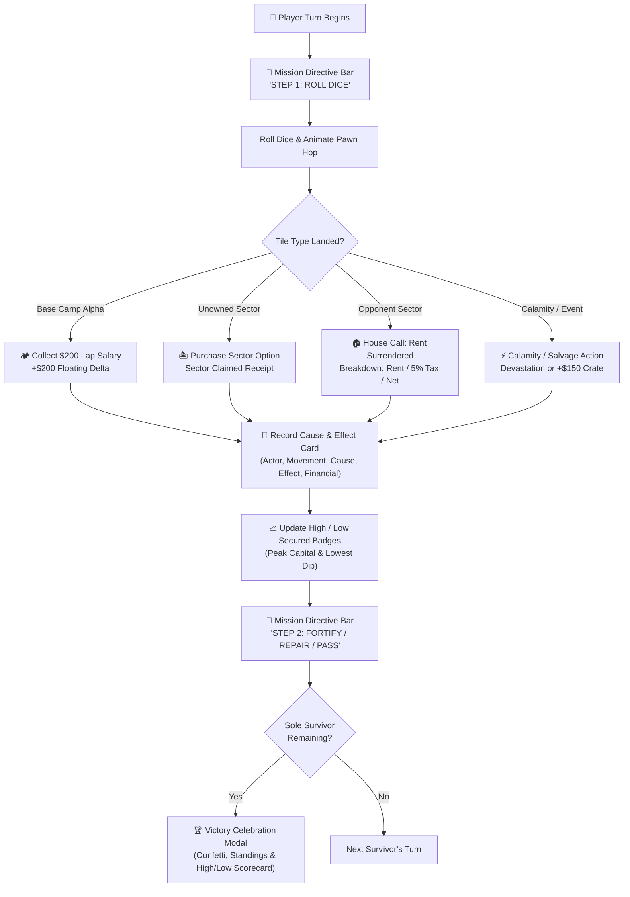

# Castaway Capital: Island of Ruin 🏝️

[](https://en.cppreference.com/w/cpp/20)
[](https://threejs.org/)
[](https://www.tornadoweb.org/)
[](https://railway.app/template)
[](https://github.com/AryanBCrazy-prog/castaway-capital/tree/sarvam-ai)

> 🎙️ **NEW: Sarvam AI Voice Announcer Edition Available!**  
> Check out the dedicated **[`sarvam-ai`](https://github.com/AryanBCrazy-prog/castaway-capital/tree/sarvam-ai)** branch for real-time Text-to-Speech narration powered by **Sarvam AI Bulbul**, multilingual Indian commentary (English & Hindi), synchronized calamity radio alerts, and dynamic leaderboard analysis!  
> Switch to it locally with: `git checkout sarvam-ai`

An interactive, turn-based survival-monopoly simulation engine and online multiplayer game. Features an authoritative real-time WebSocket game server, room-code matchmaking, realistic physical note currency mechanics, an interactive Three.js WebGL island board, action cause-and-effect history ledger, and clear visual transaction receipts.

---

## 🌿 Available Branches

| Branch | Description | Key Capabilities |
| :--- | :--- | :--- |
| **[`main`](https://github.com/AryanBCrazy-prog/castaway-capital)** | Core 3D multiplayer WebSocket game engine & board clarity | C++20 engine, Three.js 3D board, named sectors, circuit minimap, cause-effect ledger, transaction receipts, high/low tracker, room matchmaking |
| **[`sarvam-ai`](https://github.com/AryanBCrazy-prog/castaway-capital/tree/sarvam-ai)** | Dedicated Sarvam AI Bulbul TTS voice edition | All core features + real-time Indian English & Hindi voice announcer, radio bulletin, audio caching (<1ms), soundwave visualizer HUD |

---

## 🧭 Clear Board & Cause-and-Effect Gameplay Architecture

To ensure players always know **what they are doing, where they are going, and what happened**, the board and gameplay loop feature comprehensive clarity upgrades:



### 1. 🏷️ Clearly Named 3D Blocks & Elevated Billboard Sprites
- **Surface Canvas Textures:** Every single tile among the 24 sectors features a 512×512 dynamic canvas texture displaying its Sector Category (e.g., Coastal, Jungle, Industrial), Block Number (`#0` through `#23`), bold sector name, purchase price, and rent.
- **Floating 3D Billboard Sprites:** Positioned above each tile block, readable from any camera angle, ensuring you never have to guess which block is which.
- **Color Coding:** 
  - Base Camp Alpha (`#0`): Golden Beacon
  - Finance Ministry (`#6`): Gold Imperial Crest
  - Max Autos Transit Hub (`#12`): Cobalt Industrial Garage
  - Calamity / Events: Crimson Warning Markers

### 2. 🗺️ 24-Block Interactive Circuit Minimap
- A dedicated interactive ribbon at the top of the board lists all 24 blocks sequentially in circuit order.
- Features real-time player pawn location badges (Red, Blue, Green, Gold).
- **Click-to-Focus:** Click any block on the minimap or 3D board to smoothly focus the camera directly on that sector.

### 3. 🎯 Active Turn Mission Directive Bar
- Positioned right below the header HUD, providing plain-English context for the active player:
  - **`STEP 1: ROLL`** — Prompts the player to roll the dice to traverse the island.
  - **`STEP 2: ACTIONS & PASS`** — Explains what occurred on the landed block and highlights optional repair/fortification actions before passing the turn.
  - **`WAITING`** — Displays who is currently moving and where they are located.

### 4. 📜 Action Cause-and-Effect History Ledger
- Dedicated **"Action Cause & Effect"** tab in the right-hand drawer.
- Every turn records a structured card detailing:
  - **Actor & Action:** Who initiated the move.
  - **Movement Path:** Exact from/to sector coordinates (e.g., `#0 ➔ #${new_pos}`).
  - **Action Cause:** What triggered the event (e.g., landing on an unowned sector or entering another player's fortified outpost).
  - **Resulting Effect:** Exact rule resolution (e.g., deed transfer, rent surrender, cyclone destruction).
  - **Financial Impact:** Exact net credits earned or deducted (`+$200`, `-$45`).

### 5. 🏠 House Call & Transaction Alert Receipts
- When a survivor enters an opponent's property, an animated cinematic receipt slides onto the screen:
  - Tenant name & Landlord name.
  - Exact property name and upgrade status (`PRISTINE` or `FORTIFIED`).
  - Total rent charged.
  - 5% royal fee routed to the Minister of Finance (if active).
  - Net profit deposited into the landlord's ledger.

### 6. 💸 Money Lost/Won Animations & High/Low Capital Badges
- **Floating Currency Particles:** Every time money changes hands, animated delta particles (`+$XX` in glowing green or `-$XX` in warning red) float upward and fade out.
- **Wallet Flash Effects:** Player wallet cards flash with emerald gain or crimson loss borders.
- **High / Low Secured Badges:** Every player's wallet card displays their **Peak High** capital attained and **Lowest Dip** experienced throughout the game.

### 7. 🏆 Victory Celebration & Survival Scorecard
- When opponents are liquidated, an end-game victory screen triggers:
  - Confetti particle canvas animation.
  - 1st to 4th Place medal standings.
  - Total Net Worth calculation (cash on hand + property market value).
  - High and Low capital secured throughout the match.
  - One-click **"Play Again"** button to restart the island simulation.

---

## 🌟 Core Game Features

- **🌐 Live Online Multiplayer:** Play with friends anywhere in the world. Create a private room, copy a 1-click invite link (`?room=CODE`), and pick your survivor color (Red, Blue, Green, Gold).
- **🤖 Autonomous Heuristic AI:** Any unclaimed player slot is seamlessly piloted by AI survivor bots that balance capital reserves, repair ruined sectors, upgrade strongholds, and sabotage opponents.
- **🎮 3D WebGL Island World:** Built with Three.js and OrbitControls. Features procedural tropical terrain, beaches, jungle foliage, and a smoking volcano caldera with glowing lava.
- **♟️ Animated 3D Pawns:** Real-time parabolic jumping arcs as dice are rolled across the 24 circular island sectors.
- **💵 Physical Currency Wallet:** 7 colorful note denominations (500, 100, 50, 20, 10, 5, 1) with an automatic bank change-making algorithm.
- **🏛️ Ministry of Finance:** Land on government sectors to acquire the Finance Manager License and automatically skim a 5% royalty on all rents and loans across the island.
- **🏎️ Max Autos Monopoly:** Transit routes grant fixed tolls and unlock tactical **Dice Tampering** (force an opponent to roll a single 1d6 instead of 2d6).
- **⚡ Island Calamity Deck:** Randomized natural disasters (Tsunamis, Ashfall, Cyclones, Malaria) that degrade upgraded sectors into `RUINED` status.

---

## 🚀 Deploying Online (Free Public Server)

### Option A: Render.com (100% Free, No Credit Card Required)
1. Go to [dashboard.render.com](https://dashboard.render.com) and sign in with your GitHub account.
2. Click **New +** ➡️ **Web Service**.
3. Select your repository: **`AryanBCrazy-prog/castaway-capital`**.
4. Render automatically reads [`render.yaml`](render.yaml):
   - **Environment:** `Python`
   - **Build Command:** `pip install -r requirements.txt`
   - **Start Command:** `python server.py`
5. Select the **Free** tier and click **Create Web Service**.
6. Render will assign you a live HTTPS domain (e.g., `https://castaway-capital.onrender.com`).

### Option B: Railway
1. In [railway.app](https://railway.app), deploy from GitHub repo and choose branch `main`.
2. In **Settings** ➡️ **Networking** ➡️ Click **Generate Domain** to get your public `https://...up.railway.app` URL.

---

## 💻 Local Quickstart

```powershell
# 1. Clone repository
git clone https://github.com/AryanBCrazy-prog/castaway-capital.git
cd castaway-capital

# 2. Install dependencies
pip install -r requirements.txt

# 3. Launch server
python server.py
```
Open **http://localhost:8080** in your browser to play!

---

## 📜 License

Distributed under the MIT License. See `LICENSE` for more information.
