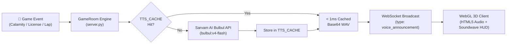
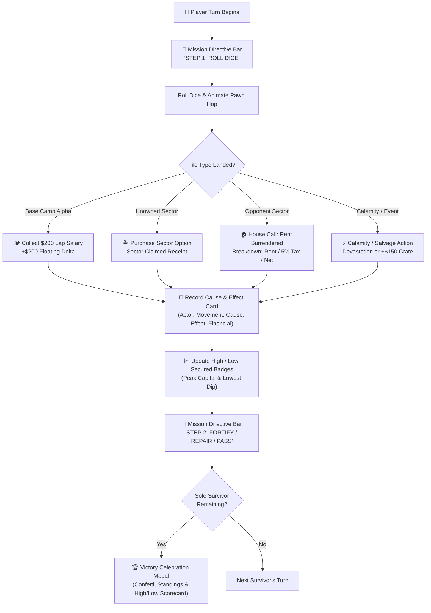

# Castaway Capital: Island of Ruin 🏝️ (Sarvam AI Voice Edition)

[](https://sarvam.ai/)
[](https://en.cppreference.com/w/cpp/20)
[](https://threejs.org/)
[](https://www.tornadoweb.org/)
[](https://github.com/AryanBCrazy-prog/castaway-capital/tree/sarvam-ai)

> 🎙️ **This is the dedicated Sarvam AI integration branch (`sarvam-ai`).**  
> Features live Text-to-Speech narration via **Sarvam AI Bulbul** (`bulbul:v4-flash` / `bulbul:v3`), multilingual Indian commentary (English & Hindi), real-time calamity radio bulletins, and dynamic leaderboard analysis.

---

## 🎙️ Sarvam AI Features in This Branch

1. **🎙️ Island Radio Announcer (3D HUD):**
   - Live Island Radio bar integrated directly into the 3D header HUD.
   - Animated audio soundwave visualizer that pulses during live synthesis.
   - Quick one-click ON/OFF mute toggle.
   - Voice persona selector:
     - **🎙️ Shubh:** Dramatic Island Radio Host (English `en-IN` / Hindi `hi-IN`)
     - **⚡ Ashwin:** High-Energy Sportscaster (`ashwin_en_sports_energetic`, `en-IN`)
     - **🌺 Ritu:** Expressive Island Guide & News Dispatch (`en-IN` / `hi-IN`)
     - **🏛️ Aditya:** Ministry Overseer (`en-IN`)
     - **🧭 Priya:** Calm Island Dispatch (`en-IN`)

2. **⚡ Real-time Calamity Radio Broadcasts:**
   - When natural calamities (Tsunamis, Ashfall, Rot Swarms) strike, the server synthesizes an urgent emergency alert that broadcasts to all players in the room simultaneously.

3. **🏛️ Ministry of Finance License Alerts:**
   - Formal island announcements when a survivor claims the 5% royalty license.

4. **💀 Survivor Bankruptcy & Lap Salaries:**
   - Audible commentary as players complete circuit laps and collect base camp salaries or get eliminated from the island.

5. **📻 On-Demand "News Bulletin" Commentary:**
   - Click the **"Bulletin"** button in the HUD or send a chat to receive dynamic game state commentary analyzing current lap status, leader standings, and ruined sectors in real-time.

6. **⚡ In-Memory Audio Caching:**
   - Common repetitive game events are cached in-memory (`TTS_CACHE`), returning audio in **< 1ms** without repeated API latency.

---

## 🏗️ Architecture & Voice Workflow



### Voice Persona Catalog

| Persona ID | Display Name | Accent / Language | Tone & Character |
| :--- | :--- | :--- | :--- |
| `shubh` | **Shubh** | Indian English (`en-IN`) | Dramatic Island Radio Host |
| `ashwin_en_sports_energetic` | **Ashwin** | Indian English (`en-IN`) | Energetic Play-by-Play Sportscaster |
| `ritu` | **Ritu** | Indian English (`en-IN`) | Expressive Island Guide & Dispatch |
| `aditya` | **Aditya** | Indian English (`en-IN`) | Formal Ministry of Finance Overseer |
| `priya` | **Priya** | Indian English (`en-IN`) | Calm Island Dispatcher |
| `shubh` | **Shubh (हिंदी)** | Hindi (`hi-IN`) | Energetic Hindi Island Commentary |
| `ritu` | **Ritu (हिंदी)** | Hindi (`hi-IN`) | Crisp Hindi Island Radio Bulletin |

---

## 🔑 Setting up Sarvam AI

1. Obtain your API key from the [Sarvam AI Dashboard](https://dashboard.sarvam.ai/).
2. Create a `.env` file in the project root:
   ```env
   SARVAM_API_KEY=your_sarvam_api_key_here
   PORT=8080
   ```
   *(Note: `.env` is already included in `.gitignore` to prevent committing your key).*
3. Install required dependencies:
   ```powershell
   pip install -r requirements.txt
   ```
4. Start the server:
   ```powershell
   python server.py
   ```
   The server will print:
   ```
   >> Sarvam AI Voice Engine initialized successfully.
   ```

---

## 📡 REST & WebSocket Voice API

### REST Endpoints

#### 1. Synthesize Speech (`POST /api/tts` or `GET /api/tts`)
**Request:**
```json
POST /api/tts
Content-Type: application/json

{
  "text": "Emergency Alert! Tsunami Surge has swept coastal sectors into ruins!",
  "speaker": "shubh",
  "language_code": "en-IN"
}
```
**Response:**
```json
{
  "status": "ok",
  "audio": "UklGRnCqAQBXQVZFZm10IBAAAAAB...",
  "text": "Emergency Alert!...",
  "speaker": "shubh",
  "language_code": "en-IN"
}
```

#### 2. Get Announcer Status & Voices (`GET /api/tts/status`)
Returns whether the Sarvam AI engine is active and the list of available personas.

### WebSocket Events
- **Incoming `voice_announcement`:**
  ```json
  {
    "type": "voice_announcement",
    "text": "Announcement text",
    "category": "calamity",
    "audio": "<base64_wav>"
  }
  ```
- **Outgoing `request_broadcast`:**
  ```json
  {
    "type": "request_broadcast",
    "speaker": "ashwin_en_sports_energetic",
    "language_code": "en-IN"
  }
  ```

---

## 🧭 Clear Board & Cause-and-Effect Gameplay Architecture (New!)

To ensure players always know **what they are doing, where they are going, and what happened**, the board and gameplay loop feature comprehensive clarity upgrades:



### 1. 🏷️ Clearly Named 3D Blocks & Elevated Billboard Sprites
- **Surface Canvas Textures:** Every single tile among the 24 sectors features a 512×512 dynamic canvas texture displaying its Sector Category (e.g., Coastal, Jungle, Industrial), Block Number (`#0` through `#23`), bold sector name, purchase price, and rent.
- **Floating 3D Billboard Sprites:** Positioned above each tile block, readable from any camera angle, ensuring you never have to guess which block is which.
- **Color Coding:** 
  - Base Camp Alpha (`#0`): Golden Beacon
  - Finance Ministry (`#6`): Gold Imperial Crest
  - Max Autos Transit Hub (`#12`): Cobalt Industrial Garage
  - Calamity / Events: Crimson Warning Markers

### 2. 🗺️ 24-Block Interactive Circuit Minimap
- A dedicated interactive ribbon at the top of the board lists all 24 blocks sequentially in circuit order.
- Features real-time player pawn location badges (Red, Blue, Green, Gold).
- **Click-to-Focus:** Click any block on the minimap or 3D board to smoothly focus the camera directly on that sector.

### 3. 🎯 Active Turn Mission Directive Bar
- Positioned right below the header HUD, providing plain-English context for the active player:
  - **`STEP 1: ROLL`** — Prompts the player to roll the dice to traverse the island.
  - **`STEP 2: ACTIONS & PASS`** — Explains what occurred on the landed block and highlights optional repair/fortification actions before passing the turn.
  - **`WAITING`** — Displays who is currently moving and where they are located.

### 4. 📜 Action Cause-and-Effect History Ledger
- Dedicated **"Action Cause & Effect"** tab in the right-hand drawer.
- Every turn records a structured card detailing:
  - **Actor & Action:** Who initiated the move.
  - **Movement Path:** Exact from/to sector coordinates (e.g., `#0 ➔ #${new_pos}`).
  - **Action Cause:** What triggered the event (e.g., landing on an unowned sector or entering another player's fortified outpost).
  - **Resulting Effect:** Exact rule resolution (e.g., deed transfer, rent surrender, cyclone destruction).
  - **Financial Impact:** Exact net credits earned or deducted (`+$200`, `-$45`).

### 5. 🏠 House Call & Transaction Alert Receipts
- When a survivor enters an opponent's property, an animated cinematic receipt slides onto the screen:
  - Tenant name & Landlord name.
  - Exact property name and upgrade status (`PRISTINE` or `FORTIFIED`).
  - Total rent charged.
  - 5% royal fee routed to the Minister of Finance (if active).
  - Net profit deposited into the landlord's ledger.

### 6. 💸 Money Lost/Won Animations & High/Low Capital Badges
- **Floating Currency Particles:** Every time money changes hands, animated delta particles (`+$XX` in glowing green or `-$XX` in warning red) float upward and fade out.
- **Wallet Flash Effects:** Player wallet cards flash with emerald gain or crimson loss borders.
- **High / Low Secured Badges:** Every player's wallet card displays their **Peak High** capital attained and **Lowest Dip** experienced throughout the game.

### 7. 🏆 Victory Celebration & Survival Scorecard
- When opponents are liquidated, an end-game victory screen triggers:
  - Confetti particle canvas animation.
  - 1st to 4th Place medal standings.
  - Total Net Worth calculation (cash on hand + property market value).
  - High and Low capital secured throughout the match.
  - One-click **"Play Again"** button to restart the island simulation.

---

- **🌐 Live Online Multiplayer:** Play with friends anywhere. Create a room, copy a 1-click link (`?room=CODE`), and pick your survivor color (Red, Blue, Green, Gold).
- **🤖 Autonomous Heuristic AI:** Any unclaimed slot is piloted by survivor bots that balance capital, repair sectors, and upgrade strongholds.
- **🎮 3D WebGL Island World:** Built with Three.js and OrbitControls. Procedural tropical terrain, jungle foliage, and an active volcano caldera.
- **💵 Physical Currency Wallet:** 7 colorful note denominations (500, 100, 50, 20, 10, 5, 1) with an automated bank change-making algorithm.
- **🏛️ Ministry of Finance:** Skim a 5% royalty on all rents and loans across the island.
- **🏎️ Max Autos Monopoly:** Transit routes grant fixed tolls and unlock tactical **Dice Tampering** (force an opponent to roll 1d6 instead of 2d6).

---

## 🚀 Cloud Deployment

### Render.com
1. Fork or push this repository to GitHub.
2. In [Render Dashboard](https://dashboard.render.com), create a new **Web Service**.
3. Choose branch: **`sarvam-ai`**.
4. Set Environment Variable: `SARVAM_API_KEY` = your Sarvam API subscription key.
5. Deploy!

### Railway
1. In [Railway](https://railway.app), deploy from GitHub repo and choose branch **`sarvam-ai`**.
2. Add variable `SARVAM_API_KEY`.
3. Generate Domain.

---

## 💻 Local Quickstart

```powershell
# 1. Checkout the branch
git checkout sarvam-ai

# 2. Install dependencies
pip install -r requirements.txt

# 3. Launch server
python server.py
```
Open **http://localhost:8080** in your browser to play!

---

## 📜 License

Distributed under the MIT License. See `LICENSE` for more information.
